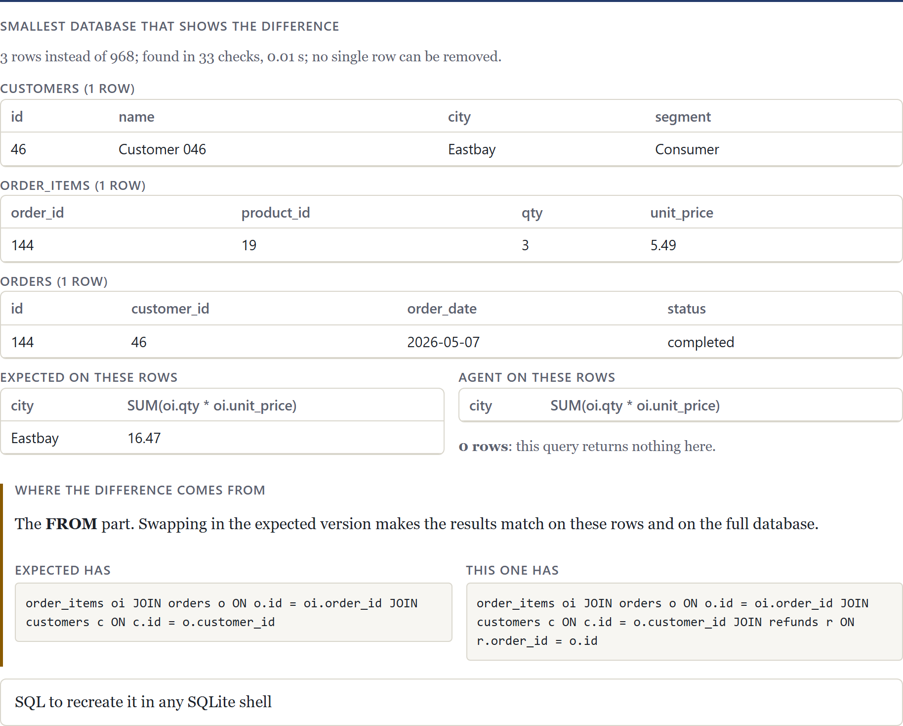

# goldcheck

**When AI-written SQL returns the wrong number, goldcheck finds the two or three real rows that prove it and names the clause that caused it.**

[](https://github.com/Kishanr7/goldcheck/actions/workflows/ci.yml)
· Windows · macOS · Linux · Python 3.10+ · SQLite / Postgres / DuckDB / Parquet · zero required dependencies



SQL that runs cleanly can still answer the wrong question: a chatbot that forgets a status filter, a refactor that drops a `DISTINCT`, a migration that joins on the wrong key. Nothing crashes, so nobody notices. goldcheck runs the query you trust next to the one you're checking, on your own data, and when they disagree it tells you:

1. **that** they disagree, and how (wrong values, missing rows, wrong order);
2. **on which rows**: a private copy of the database is cut down, by delta debugging, to the smallest set of *real* rows that still shows the difference;
3. **in which clause**: clauses are swapped for the trusted version and re-run, so "the WHERE clause" is proven by execution, not guessed;
4. **how to keep it fixed**: each case becomes a standalone regression test.

## Results on real model errors

On [BIRD](https://bird-bench.github.io/), a public text-to-SQL benchmark with databases of up to a million rows, ChatGPT's published answers are silently wrong 879 times. On a random sample of 100 of those, never used during development:

| | |
|---|---|
| Shrunk to ≤10 real rows, proven minimal | **100 / 100** (99 / 100 on a second sample) |
| Typical counterexample | **2 rows**, found in **0.27 s** |
| Cause pinned to one or two clauses | 67% |
| Wrong answers caught by `check_sql` with **no gold answer** (all 879) | **50%**, with **0.9%** false alarms on correct answers; its suggestion alone fixes 77 |

The largest case went from 1,067,081 rows to 4 in 9 seconds. The full story, including what kinds of mistakes the AI made, is in **[docs/WRITEUP.md](docs/WRITEUP.md)**.

> **Status: portfolio project, v0.5.** Built and benchmarked on public data; not yet adopted by a team in production. goldcheck is designed for places where SQL checking is automated: eval suites for chat-with-your-data products, query refactors and migrations gated in CI, and AI agents verifying their own SQL. That's what the CI exit codes, regression-test export and MCP server are for.

## Commands

| Command | Use it when | Needs |
| --- | --- | --- |
| `check` (`run`) | Scoring a chat-with-your-data agent against known-good answers | questions with gold SQL |
| `compare` | You rewrote, refactored, optimised or migrated a query (or an AI did) and want to know whether the result changed | the old query and the new one, **no gold answers** |
| `shrink` | You want one counterexample database as a file | as `check` |
| `--export-tests` | You want each difference as a test that fails until it is fixed | either of the above |
| `check-sql` | A bot or person wrote a query and you have **no known-good answer**: catch text values that are not in the data (`'Completed'` vs `'completed'`, `'single'` vs `'-'`) and empty results | just the query |
| `describe` | You (or an agent) want to see how values are really written before writing SQL | nothing |
| `mcp` | A chatbot or coding agent should check its own SQL before answering (all three checks as tools) | an MCP client |

## Install

Needs Python 3.10+.

```
pip install git+https://github.com/Kishanr7/goldcheck
pip install "goldcheck[all] @ git+https://github.com/Kishanr7/goldcheck"   # optional: DuckDB, Parquet/CSV/JSON and Postgres
```

That puts a `goldcheck` command on your PATH, usable from any folder. (`python -m goldcheck` does the same.) Run it from a folder you can write to, such as your Documents, not `C:\Windows\System32`: reports are written to the current folder unless you pass `--out`.

## Try it in one minute

```
goldcheck demo --out gc-demo
```

It builds a fictional shop database, scores a deliberately careless agent and writes `gc-demo/report.html`:

```
Shrunk 4 silent difference(s) to 1-4 row(s) each; see the report.
7/12 correct (58%, 95% interval 32-81%)
4 ran cleanly but returned the wrong result; 1 failed visibly.
```

In the report each silent failure shows the expected and actual results, then **the smallest database that shows the difference** (e.g. 3 rows instead of 968: one customer, one order, one item, on which the agent's extra join to `refunds` returns nothing) and **where the difference comes from** (the FROM clause: the agent joins `refunds`).

The demo also writes a query and a "refactored" version of it, and prints the command to compare them:

```
goldcheck compare --db gc-demo/demo.sqlite --old gc-demo/old_query.sql --new gc-demo/new_query.sql
```

The refactor reorders the joins (harmless) but also changes `status = 'completed'` to `status <> 'cancelled'`, so pending orders sneak into revenue. goldcheck reports the difference, a 6-row counterexample and the guilty WHERE clause, and exits with code 1.

## Check a query with no gold answer

A large share of wrong answers from text-to-SQL bots are not bad SQL (42% in our BIRD sample, `docs/ERROR_TAXONOMY.md`): the bot compares a column with a value the data never contains. `check-sql` runs the query read-only and checks every text value it compares a column with:

```
goldcheck check-sql --db shop.sqlite --sql "SELECT COUNT(*) FROM orders WHERE status = 'Completed'"
```

```
ERROR: orders.status = 'Completed': no row has this value, so this condition matches nothing
  closest real values: 'completed'
```

It also warns when a `!=` or `NOT IN` filter removes nothing and when the result is empty, and exits 1 on errors, so a bot or a CI job can act on it. To look before writing, `describe` shows tables, columns, or one column's real values with counts:

```
goldcheck describe --db shop.sqlite --table orders --column status
```

On the 1,224 ChatGPT answers to BIRD questions that run cleanly, it flagged **50% of the wrong ones** and **0.9% of the correct ones**. When it says a value is not in the data it is right 99% of the time, and applying its top suggestion alone turned 77 wrong answers into correct ones (`benchmarks/check_sql_bird.py`). It only checks comparisons with text literals; a wrong join or aggregate needs `compare`.


## Compare an old and a new query

```
goldcheck compare --db shop.sqlite --old old.sql --new new.sql
```

`--old` and `--new` take a `.sql` file or the SQL itself. For many pairs use `--pairs pairs.jsonl` with one `{"id", "old", "new", "note"?, "ordered"?}` per line. Output:

```
Shrunk 1 silent difference(s) to 6 row(s) each; see the report.
0/1 pair(s) return the same result; 1 differ (1 silently, 0 with an error in the new query).
  pair: no column of the result holds the expected values of column 2. Smallest database: 6 row(s). Comes from the WHERE clause.
```

Exit code 0 means every pair returned the same result on this database, 1 means at least one differs, and 2 means bad input. That lets you use it as a CI gate on query refactors. Same result on one database is evidence, not proof of equivalence.

## Score a chatbot

1. Questions with gold SQL (`questions.json`): `[{"id": "q1", "question": "How many customers?", "gold_sql": "SELECT COUNT(*) FROM customers"}]`. Add `"ordered": true` when row order matters.
2. The agent's SQL as JSON Lines (`{"id": "q1", "sql": "..."}` per line), or a command goldcheck calls per question:
   ```
   goldcheck run --db shop.sqlite --questions questions.json --answers answers.jsonl --shrink
   goldcheck run --db shop.sqlite --questions questions.json --agent-cmd "my-agent --sql {question}" --shrink
   ```
3. `--min-accuracy 0.8` fails a CI job below a threshold. `--json` prints machine output.

## Lock it in a test

Add `--export-tests regressions/` to `run --shrink` or `compare`. Each difference becomes a folder with `fixture.sql` (the tiny database), `query.sql`, `reference.sql` and `expected.json`, plus one `test_regressions.py` that needs only Python:

```
python -m unittest discover -s regressions
```

Each case fails while the bug is there. Put the fixed SQL in `query.sql` and it passes. The fixtures contain real rows from your database, so review them before sharing.

## DuckDB, Parquet, CSV and JSON

Point `--db` at a `.duckdb` file, a `.parquet`, `.csv` or `.json` file, or a folder of them (each file becomes a table named after it). Everything works the same: `run`, `compare`, shrinking, clause blame, `--export-tests` and MCP.

```
pip install duckdb
goldcheck compare --db exports/ --old old.sql --new new.sql
```

Question SQL runs on goldcheck's own in-memory copy, after DuckDB's `enable_external_access = false` and `lock_configuration = true`. That blocks file reads and writes, `COPY`, `ATTACH` and extension installs, and the setting cannot be switched back. Only one `SELECT` is accepted per query, and each has a timeout. Data loaded from files is held in memory, so very large folders need a sample. Queries must be valid DuckDB SQL: SQLite-only SQL, such as selecting an ungrouped column, is rejected as an error.

## Postgres

```
pip install "psycopg[binary]"
goldcheck compare --db postgresql://reader@db.internal/sales --old old.sql --new new.sql
```

goldcheck never writes to your database:

- Question SQL must start with SELECT, WITH, VALUES or TABLE. It is sent so that the server accepts exactly one statement, runs in a `READ ONLY` transaction, inside a savepoint that is always rolled back, with a statement timeout.
- To shrink, goldcheck finds the tables the two queries read with `EXPLAIN` (which does not run them) and copies only those into session-private `TEMP` tables, which Postgres drops when the session ends. Unqualified table names then resolve to the copies. If a query names a schema explicitly (`public.orders`), goldcheck refuses to shrink rather than risk reading the real table. Copies are capped at 2,000,000 rows.
- Declared foreign keys are respected: deleting a row deletes the rows that point at it.
- The counterexample is written as a `.sql` script (`--out cx.sql`). Exported regression tests read the database from `GOLDCHECK_PG_URL` and only create `TEMP` tables.
- The connection URL is never printed or written to reports or exported files. Prefer a URL without a password plus `PGPASSWORD`, and a role that can only read the tables involved and create temporary tables.

## Plug it into a chatbot or agent (MCP)

`goldcheck mcp` is an MCP server: a small program the bot's MCP client starts next to the bot and talks to over stdin/stdout. It gives the model three tools:

| Tool | When the model should call it |
|---|---|
| `check_sql(sql)` | Before answering from any query: catches text values that are not in the data (with the closest real ones), filters that remove nothing, empty results. No gold answer needed. |
| `describe_values(table?, column?)` | Before writing a query: how values are really written (codes, case, date formats). |
| `compare_queries(trusted_sql, sql)` | After rewriting a query whose original is known to be right: the smallest real rows that show any difference, and the clause that causes it. |

**How it reaches the database.** goldcheck does not sit between the bot and the database, and it does not take over the bot's own connection. It opens its own connection, read-only, to the databases you name when you start it:

```
goldcheck mcp --db sales=postgresql://goldcheck_reader@db.internal/sales --db finance=postgresql://goldcheck_reader@db.internal/finance
```

The model only ever sees and sends the names (`sales`, `finance`), never connection strings or passwords. Put the password in `PGPASSWORD` or `~/.pgpass`, not in the URL. With one database, `GOLDCHECK_DB=postgresql://...` does the same, and the model does not even need to name it. Without `--db`, the tools take a `db_path` argument instead, which suits local files on your own machine (`--allow-paths` permits both).

```
                       ┌──────────────── the bot's machine or container ────────────────┐
user ──question──▶  bot / agent (LLM) ──tool call: check_sql(database="sales", sql)──▶ goldcheck mcp
                       │                ◀──findings: "status='Completed' not in data; did   │   │
                       │                    you mean 'completed'?"                           │   │ own read-only
                       └─────────────────────────────────────────────────────────────────┘   │ connection
                                                                                              ▼
                                                                                         company database
```

Setup per client:

- **Claude Code:** `claude mcp add goldcheck -- goldcheck mcp --db sales=postgresql://goldcheck_reader@db.internal/sales`
- **Claude Desktop, Cursor and other MCP clients:** add a server entry with command `goldcheck` and args `["mcp", "--db", "sales=..."]`.
- **Your own agent** (Claude Agent SDK, LangChain/LangGraph MCP adapters, the official `mcp` Python SDK): start `goldcheck mcp` as a stdio server; the tools appear like any other.

For production, give goldcheck its own database role that can only `SELECT` the tables the bot uses (and, on Postgres, create temporary tables for `compare_queries`). Every query also runs read-only, single-statement and time-limited inside goldcheck, as described in Safety. The server is tested with the official MCP Python SDK on Windows, macOS and Linux.

## How shrinking works

goldcheck copies the database file to a private temporary file. It finds which tables the two queries read from SQLite's own query plan, and deletes rows from those tables in shrinking chunks (delta debugging). Every deletion runs inside a SAVEPOINT and is kept only if both queries still run and still disagree. It stops when no single row can go, or after 60 s (`--shrink-seconds`), and the report says which.

First it tries one guess: rows equal to a text literal in either query (e.g. the post titled "Analysing wind data with R") plus rows linked to them by declared foreign keys. The guess is verified like any other step. On large databases it turns minutes into seconds.

- Your database file is only read. Question SQL runs under a SELECT-only authorizer with a timeout, on the copy as well.
- Declared foreign keys never gain a new dangling reference, and rows that kept rows point at are exported too. Undeclared relationships are not protected.
- Only rows are removed, never values changed. The working copy needs free disk space equal to the database size.

## Measured

| Data | Result |
| --- | --- |
| Demo, 4 silent failures | 1–3 rows each, each blamed on one clause and confirmed on the full database |
| 51 mechanical mutants of the demo's gold queries | 51/51 shrank to ≤8 rows (median 3) in ≤0.02 s |
| BIRD dev, 200 real ChatGPT errors (two random samples, one never seen during development) | 199/200 shrank to ≤10 real rows, all proven minimal, median 2 rows in 0.25 s, from tables of up to 1,067,081 rows; cause pinned to 1–2 clauses in 66% |

Reproduce: `python benchmarks/mutants.py`; for BIRD see `benchmarks/README.md`.

## How it compares

- **[VeriEQL](https://github.com/VeriEQL/VeriEQL) and [SpotIt+](https://github.com/ai-ar-research/SpotIt-plus)** build counterexamples with an SMT solver. They can find differences your data never triggers, which goldcheck cannot. Their rows are synthetic, they need a custom Z3 build (SpotIt+ also uses an LLM for constraint mining), and some queries cannot be encoded (SpotIt+ reports 3–7% on BIRD). goldcheck uses real rows, runs any SELECT SQLite runs, and needs only Python.
- **Result diff tools** (DataComPy, `assertDataFrameEqual`, Datafold) show *that* outputs differ, on all rows. goldcheck shrinks the *input* to the few rows that cause the difference and names the clause.

## What "correct" means

Results match when they contain the same rows, ignoring column names, column order, extra columns in the checked query, and numeric differences beyond six significant digits. Order matters only when `ordered` is set. See `docs/RELIABILITY_CONTRACT.md`.

## Limits

- SQLite, Postgres and DuckDB (including Parquet, CSV, JSON). For other warehouses, export a sample. Foreign keys are respected in SQLite and Postgres, not DuckDB.
- Each engine runs its own SQL dialect: a query written for SQLite may be an error in Postgres or DuckDB, and goldcheck reports it as such.
- A pass means "matches the trusted query on this database", not "correct everywhere".
- Clause blame swaps one clause at a time. Queries that differ in several clauses at once, or that use top-level `WITH` or `UNION`, get a counterexample but no single clause.
- Tables `WITHOUT ROWID` cannot be shrunk.

## Privacy and safety

No network calls, no telemetry. `--agent-cmd` runs a command you supply, with your permissions. Exported fixtures and reports contain real rows from your database. Details: `docs/THREAT_MODEL.md`.

## Tests

```
python -m unittest discover -s tests
```

42 of the 55 tests need nothing installed. The rest cover DuckDB (`pip install duckdb`), the official MCP client (`pip install mcp`) and Postgres (set `GOLDCHECK_TEST_PG_URL` to a throwaway database). GitHub Actions runs everything on Windows, macOS and Linux with Python 3.10 and 3.13, plus a Postgres 17 service. The HTML report is checked in 11 browser setups (Windows Chrome/Edge, Mac Safari/Chrome, four iPhones including a 320 px screen, two Androids, iPad) in light and dark mode with `tools/xbrowser/report-test.js`.

## More

- [docs/WRITEUP.md](docs/WRITEUP.md): the problem, the method and the BIRD results
- [docs/ARCHITECTURE.md](docs/ARCHITECTURE.md): how the pieces fit
- [docs/ERROR_TAXONOMY.md](docs/ERROR_TAXONOMY.md): the 99 real mistakes, classified
- [docs/RELIABILITY_CONTRACT.md](docs/RELIABILITY_CONTRACT.md) · [docs/THREAT_MODEL.md](docs/THREAT_MODEL.md)
- [CHANGELOG.md](CHANGELOG.md) · [SECURITY.md](SECURITY.md) · [CONTRIBUTING.md](CONTRIBUTING.md)

MIT licence. To remove it: `pip uninstall goldcheck`, then delete any reports, `gc-demo/` or exported test folders it wrote. It stores nothing elsewhere.
